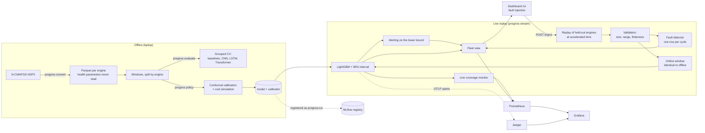
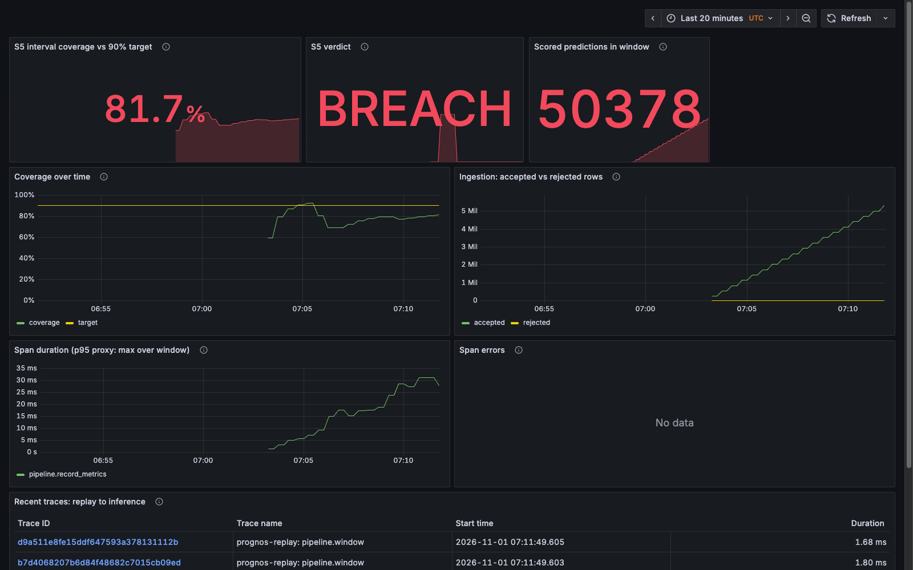
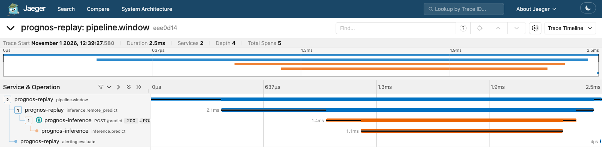

# Prognos

A turbofan engine's sensors drift as it wears, long before it fails, but a single
remaining-life estimate gives a maintenance planner no idea how far to trust it.
Prognos predicts each engine's remaining useful life with a calibrated 90% interval
from NASA N-CMAPSS sensor data, turns that interval into maintenance decisions priced
against simple policies, and runs it all on a live replayed fleet that names its own
sensor faults instead of predicting through them.


[Watch the 2-minute demo (MP4)](docs/media/demo.mp4). Live hosted demo: not yet
deployed. Research demonstration on simulated engines; read the
[Limitations](#limitations) before drawing any operational conclusion.

## Results at a glance

Every figure comes from a committed result file, produced by the command next to it,
on an Apple M5 with 16 GB (macOS, Python 3.12.13). `tests/test_results.py` and
`tests/test_bench.py` fail CI if a quoted figure drifts from its file.

| Question | Result | Baseline | How it was measured | Reproduce |
| --- | --- | --- | --- | --- |
| How accurate is the RUL point estimate? | CNN 7.40 cycles RMSE (95% CI 4.61–10.20) | 8.90 from cycle number alone, no sensors; 23.76 predicting the mean | 5-fold CV grouped by engine, 29 engines, 10-engine test group not used | `prognos evaluate --sequence` → [`phase3_sequence.json`](results/phase3_sequence.json) |
| Do sensors help where it matters, late in life? | Transformer 3.76 RMSE in late life | 8.84 from cycle number alone | Same folds, error split by life stage | same |
| Do the intervals hold? | 0.926 offline, 0.991 live, target 0.90 | — | Split conformal, calibrated on engines held out of the fit | `prognos policy`, `prognos stream` |
| What does it save? | 30.8 total cost for the best policy | 577.3 run-to-failure, 44.0 best fixed interval | 19 engines, 2,000 cycles, failure 25× a planned visit, ratio swept 1–100 | `prognos policy` → [`phase4_policy.json`](results/phase4_policy.json) |
| How fast is the live path? | p99 0.65–0.70 ms per updated prediction; at least 128,435 readings/s in this run, 43,141 in v1.0.0's | — | Real engines interleaved at fleets of 10, 100 and 1,000, 5 rounds | `prognos bench` → [`phase6_streaming_bench.json`](results/phase6_streaming_bench.json) |
| Are sensor faults named? | 4 of 4 injected faults named, clean control | — | Each fault injected alone into a clean engine | `prognos stream --faults` → [`phase5_faults.json`](results/phase5_faults.json) |
| Does drift detection stay quiet on healthy engines? | 0 of 9 held-out engines alarmed | 4 of 9 before tuning | Tuned on 10 development engines only, judged on 9 held-out | `prognos drift-study` → [`phase6_drift.json`](results/phase6_drift.json) |
| How does it compare with published DS02 results? | Sensor-only Transformer 6.47 RMSE on units 11, 14 and 15 | Published Transformer 6.54, best published (THGNN) 5.59 | The published split, run once with the code frozen; the cycle input removed | `prognos final-ds02` → [`final_ds02.json`](results/final_ds02.json) |
| Does the system name its own failures? | 5 of 5 provoked failures named | Clean control names nothing | Inference outage, operating shift beyond and within the fleet, silence, late data, on real engines | `prognos failures` → [`phase6_failures.json`](results/phase6_failures.json) |

Three results go against what was hoped for and are reported as they came out: acting
on the interval's lower bound costs **more** than acting on the point estimate on this
data; the drift detector, now quiet on healthy engines, cannot see drift on 6 of 14
sensors; and an operating-condition shift inside the fleet's experience goes unnamed.
All three are explained below. Against published DS02 results, on the full split with
sensors only, the best model here is comparable to a published Transformer and behind
the best published model.

## Architecture



Design: [`docs/design.md`](docs/design.md), with decisions in [`docs/adr/`](docs/adr/).

## Run it locally

Needs [uv](https://docs.astral.sh/uv/) and about 2.5 GB of N-CMAPSS HDF5; where to
get it and its terms of use are in [`docs/data.md`](docs/data.md).

```bash
uv sync --locked
uv run prognos convert --config configs/base.yaml          # HDF5 -> Parquet, ~1 min
uv run prognos evaluate --config configs/base.yaml --out results/phase3_sequence.json --sequence --epochs 30
uv run prognos policy --config configs/base.yaml           # intervals and costs, ~5 min

# The live dashboard: trains the serving model, then replays the fleet.
uv run prognos stream --config configs/base.yaml --serve --pace 10000 --out /tmp/replay.json
open http://127.0.0.1:8090/ui

# Every command records an MLflow run under mlruns/; stream also registers the model.
uv run prognos export-model --ref models:/prognos-rul@serving --out artifacts/model
uvx mlflow ui --backend-store-uri sqlite:///mlruns/mlflow.db   # browse runs and versions

# Latency and throughput, after `prognos stream` has written artifacts/model.
uv run prognos bench

# The stack: the replay, four services, Prometheus, Grafana and Jaeger.
# Needs a token in ops/prometheus-token.txt and a model in artifacts/model; see docs/runbook.md.
uv run prognos export-model --ref models:/prognos-rul@serving --out artifacts/model
PROGNOS_API_TOKEN=$(cat ops/prometheus-token.txt) docker compose up -d --build
PROGNOS_API_TOKEN=$(cat ops/prometheus-token.txt) uv run prognos verify-stack
```

The test suite needs no NASA data: `uv run pytest -m smoke` runs the whole pipeline on
a synthetic subset, which is what CI does.

## Streaming latency and throughput

```bash
uv run prognos bench    # fleets of 10, 100 and 1,000 engines, 5 interleaved rounds
```

Latency is from a sensor reading handed to the pipeline to the updated prediction it
returns: fault detection, operating-shift tracking, the online window, features,
LightGBM, the conformal interval, alerting, the fleet view, and the OpenTelemetry spans
around each window. It is timed only for readings that complete a window, about one in
a hundred. Throughput is readings per second through one Python process. N-CMAPSS
records at 1 Hz, so readings per second is also the number of engines one process
keeps up with in real time. Fleets are built from the 19 cross-validation engines,
interleaved one reading per engine in turn, so every engine keeps its own window,
detector and shift tracker live at once.

| fleet size | readings/s, median (min–max of 5) | predictions/s | p50 ms | p95 ms | p99 ms | worst p99 ms |
| --- | --- | --- | --- | --- | --- | --- |
| 10 | 136,534 (128,435–149,875) | 1,183 | 0.55 | 0.60 | 0.70 | 0.76 |
| 100 | 136,788 (128,652–154,322) | 1,165 | 0.56 | 0.59 | 0.65 | 0.69 |
| 1,000 | 132,729 (128,982–150,550) | 1,129 | 0.58 | 0.62 | 0.66 | 0.67 |

The inference service over loopback HTTP, one window per request: p50 0.98 ms, p95
1.05 ms, p99 1.10 ms over 2,000 requests. That hop is not in the figures above.

Hardware: Apple M5 (10 cores, one used), 16 GB, macOS 26, Python 3.12.13, LightGBM
4.6.0. Raw runs: [`results/phase6_streaming_bench.json`](results/phase6_streaming_bench.json).

**Fleet size does not change the cost per reading between 10 and 1,000 engines.** The
slowest round here is 128,435 readings a second.

**This machine's speed is not stable, and that matters more than the table.** The
v1.0.0 run on the same laptop
([`phase6_streaming_bench.json` at v1.0.0](https://github.com/pavan-dangeti/Prognos/blob/v1.0.0/results/phase6_streaming_bench.json))
had rounds in two clusters, about 50,000 and about 160,000 readings a second, decided
by when a round ran rather than its size; its slowest round was 43,141. This run had
every round in the fast cluster, and its HTTP figures are a third of v1.0.0's, which no
code change made faster. Both are consistent with macOS moving an unpinned process
between performance and efficiency cores, which I cannot control here. So the planning
figure stays the slowest round either run has seen, 43,141 readings a second, and the
sizes are interleaved so the drift cannot pose as a trend. Comparing the two runs
cannot isolate what tracing and shift tracking cost; only an instrumented run on a
pinned core could.

**Measuring this found the detector being fed the wrong data.** As Phase 5 shipped
it, the live path handed the fault detector every raw reading, about 11,000 per
cycle, although the detector is designed to judge an engine cycle to cycle and the
fault results were measured that way. It was by far the largest cost in the pipeline.
It now sees the first reading of each cycle, and the live fleet coverage is unchanged
by the fix.

## Limitations

What this project is not:

- **No physics-based degradation model.** Everything here is learned from sensor
  data, and nothing claims a physics model is unnecessary. A hybrid would likely be
  more robust to operating regimes the training engines never saw.
- **No real aircraft data.** Every engine is simulated by NASA's C-MAPSS model under
  realistic flight profiles. No aircraft flew them, and no result transfers to a real
  fleet without being re-measured on one.
- **No safety or airworthiness claim.** This is a research demonstration. It must not
  be used to decide whether an engine or an aircraft is safe to operate.

What the evidence does not support:

- **Small data.** 29 engines in total, 19 in cross-validation. The confidence
  intervals on model comparisons are wide; the CNN and Transformer intervals overlap
  the no-sensor baseline's, and the life-stage split is the stronger evidence.
- **Three of nine sub-datasets.** DS01, DS02 and DS06. Claims about failure-mode
  generality rest on DS06 alone.
- **The cost model is an assumption set,** not airline economics. Planned maintenance
  is normalised to 1 and failure is swept from 1× to 100×; planning loses at 1× and
  wins from 5× up.
- **Intervals are wide and only marginally valid.** Mean width 38 cycles on a scale
  capped at 125. Conformal prediction guarantees coverage on average over
  exchangeable data, not per engine, per life stage, or under a shift in operating
  conditions. Live coverage over-covers at 0.991, outside the 0.90 ± 0.05 band on the
  safe side.
- **The lower-bound policy is not the cheapest here.** The point estimate already
  prevents every failure on these engines, so the lower bound buys insurance nothing
  needed.

What the system does not yet do:

- **The drift detector is blind on 6 of 14 sensors.** `P15`, `P2`, `P21`, `P24`, `P50`
  and `Wf` are never named at any step size, because a shift must also exceed the
  fleet's typical spread. Detection of a 5× step tops out at 57%. Its false-alarm rate
  is 0 of 9 held-out engines, measured on 9 engines.
- **An operating shift on strictly alternating flights is not named.** The tracker needs
  two flights outside in a row before it opens, which ordinary scatter needs to be kept
  out by. Every other shift tested, inside or beyond the fleet, is named with one alert.
- **The published comparison is close, not identical.** The full DS02 split and
  sensor-only inputs now match, but it is one seed against a mean of five subsamples,
  and the published table does not state its sampling or what one RMSE sample is.
- **The final test group is partly open.** DS02 units 5, 11 and 20 were opened once for
  the published comparison. The other seven closed engines have still not been scored.
- **Not yet built:** a hosted demo.
- **Latency is measured on a laptop against a replay,** at accelerated time, not on an
  aircraft datalink, and the HTTP figure is loopback only.
- **Maintenance is assumed schedulable at any threshold.** Real maintenance has
  calendar, hangar and crew constraints this simulation does not model.

## Detailed results

5-fold grouped cross-validation, 29 engines from DS01, DS02 and DS06, 199,095
windows. Intervals are 95% bootstrap resampling **by engine**, not by window. The
final test group of 10 engines was held closed for every one of these models; three of
its DS02 engines were later opened once, for the published comparison only.

| model | rmse | nasa_score | rmse 95% CI | params | how measured |
| --- | --- | --- | --- | --- | --- |
| `cnn` | 7.40 | 24,343 | 4.61–10.20 | 113,665 | grouped CV, 1D CNN over the window |
| `transformer` | 7.43 | 24,396 | 5.39–9.47 | 68,417 | grouped CV, 2-layer encoder |
| `lightgbm` | 8.15 | 30,027 | 4.23–12.07 | — | grouped CV, window statistics + cycle context |
| `linear_cycle` | 8.90 | 34,950 | 4.62–13.18 | — | grouped CV, RUL ~ cycle number, **no sensors** |
| `lstm` | 13.00 | 65,732 | 10.58–15.41 | 55,105 | grouped CV, 2-layer LSTM |
| `mean` | 23.76 | 283,059 | 22.08–25.44 | — | grouped CV, training-set mean RUL |
| `trend` | 25.87 | 557,375 | 25.09–26.65 | — | grouped CV, per-channel trend to threshold |

Reproduce:

```bash
uv run prognos convert --config configs/base.yaml
uv run prognos evaluate --config configs/base.yaml --out results/phase3_sequence.json --sequence --epochs 30
```

Raw output: [`results/phase3_sequence.json`](results/phase3_sequence.json).
`tests/test_results.py` fails CI if any figure in this table drifts from a committed
result file.

Hardware for every number: Apple M5, 16 GB, macOS, Python 3.12.13, torch 2.10.0 on
MPS. The full seven-model run takes about 55 minutes, dominated by the Transformer.
~45 s of that is materialising 199,095 windows.

Every committed result file records the machine, the library versions and the date it
was produced in, so a number can be traced to the software that made it. That field
was added after an experiment on a different torch build silently overwrote a result
file — nothing in the file distinguished the two runs, which is exactly the kind of
gap that makes a result unfalsifiable.

The run is deterministic: re-running both commands on the same machine reproduces
every figure in the table to the last printed digit, sequence models included. CNN
7.40, Transformer 7.43, LSTM 13.00, LightGBM 8.15.

### Does sensor data actually help?

This is the question Phase 3 exists to answer, and `linear_cycle` is the control for
it. That model uses **no sensor data at all** — just cycle number — and reaches 8.90
RMSE. A sequence model that cannot beat it has not shown that sensor channels
contribute anything beyond knowing the engine's age.

The CNN at 7.40 does beat it, by 1.5 cycles. So do the life-stage numbers, which are
more informative than the headline:

| model | early | mid | late |
| --- | --- | --- | --- |
| `transformer` | 9.38 | 7.80 | **3.76** |
| `cnn` | 9.30 | 7.64 | **4.16** |
| `lightgbm` | 9.04 | 8.71 | 6.37 |
| `linear_cycle` | 8.93 | 8.77 | 8.84 |

`linear_cycle` is flat across life stages, which is exactly what a model that only
knows the engine's age should be. The sequence models are worse early — where there
is little to detect yet — and roughly **half** as good late, where degradation is
visible and where maintenance decisions are actually made. That asymmetry is the
evidence that the sensors are carrying degradation information, and it is the part
that matters operationally.

Honest caveat: the CNN/Transformer confidence intervals overlap the `linear_cycle`
interval. At 29 engines, 1.5 cycles of separation is suggestive, not conclusive. The
life-stage split is the stronger evidence because it is a within-model comparison
against a model that cannot improve by learning the sensors.

### The two results worth arguing about

**The LSTM failed.** 13.00 RMSE, clearly worse than the cycle-only floor. Its
life-stage pattern is the diagnosis: 14.06 early, 7.63 mid, 15.02 late. The middle
is the best of any model in the table; the ends are the worst. It is reading the
trajectory only where the trajectory is locally informative and falling back
toward the mean elsewhere. The architectural suspect is the readout — it uses only
the final hidden state, discarding the intermediate states, while both the CNN and
the Transformer pool over the whole window. Pooling is the obvious fix and it has
**not** been applied, because validating it on these folds would be tuning on the set
being reported. It belongs in a run with a different seed and a fresh fold assignment.

**The degradation-trend baseline got worse, as predicted.** Phase 2 recorded RMSE
37.73 in late life and attributed it to the window being too short to estimate a
channel's slope. That prediction held: it is 37.73 again here, unchanged, because
nothing about the window changed. The method is sound; the input does not support it
at downsample 10 and length 50.

## Prediction intervals and the maintenance policy

Phase 4. Conformal intervals calibrated on engines held out of the fit, and a cost
comparison of four maintenance policies on the same 19 engines over a 2,000-cycle
horizon.

Calibration gets its own engines: within each fold the training engines split again
into a fitting set and a calibration set, so the coverage below is not inflated by
residuals from engines the model memorised. `tests/test_results.py` checks that
disjointness per fold from the committed artifact. The 10-engine final test group was
not used.

```bash
uv run prognos policy --config configs/base.yaml --out results/phase4_policy.json
```

### Intervals

LightGBM, 5-fold grouped CV, target 90% coverage. ~5 minutes.

| method | coverage | 95% CI | mean width | point RMSE |
| --- | --- | --- | --- | --- |
| split conformal | 0.926 | 0.811–0.998 | 38.0 | 10.00 |
| CQR (0.05/0.95 quantiles) | 0.929 | 0.813–1.000 | 41.8 | 10.00 |

Both clear the R6 SLO. Three things are worth being blunt about:

**The intervals are wide.** Mean width 38 on an RUL scale capped at 125 is about 30%
of the entire range. This is a valid instrument and a weak one: it tells you the
model is uncertain across a third of the operating range, which is not sharp enough
to schedule against.

**CQR did not beat split conformal, and the design document expected it to.** §4.4
argued CQR should be narrower because it adapts width to where the model is
uncertain. It is wider: 41.8 against 38.0. The quantile regressors at 0.05/0.95
already produce a broad band, and the conformal correction on top of it makes the
result broader still. Reporting it as the plan did would have been the easier
story and the false one.

**Coverage is marginal, and conditional coverage is not uniform.** By life stage:
early 0.908, mid 0.908, late 0.961. The aggregate clears 90% partly because late-life
over-covers. A conformal interval promises marginal coverage over exchangeable
points — not per engine, not per stage, not under drift. That is why S5 exists.

The point RMSE is 10.00 here against 8.15 in Phase 3. That is the cost of the nested
split: this harness fits on roughly 70% of each fold's training engines instead of
all of them. Both are reported; the better number would not have been comparable.

### Cost of the policies

Costs are normalised so a planned visit is 1.0, because absolute scale cancels out of
every comparison — all policies fly the same fleet over the same horizon. The only
term that changes the answer is the failure/planned ratio, so that is what is swept.
Downtime is charged at the same rate to planned and unplanned work, leaving the ratio
as the single asymmetry.

Failure/planned ratio 25, the headline row:

| policy | total cost | planned visits | failures | vs run-to-failure |
| --- | --- | --- | --- | --- |
| `threshold_point_10` | **30.8** | 28 | 0 | **−546.5** |
| `fixed_interval_50` | 44.0 | 40 | 0 | −533.3 |
| `threshold_lower_10` | 46.2 | 42 | 0 | −531.1 |
| `threshold_lower_40` | 115.5 | 105 | 0 | −461.8 |
| `fixed_interval_125` | 419.2 | 16 | 16 | −158.1 |
| `run_to_failure` | 577.3 | 0 | 23 | 0 |

Every policy that plans beats waiting for engines to break, and the cheapest calendar
is 125 cycles, not 50 — replacing on a short schedule spends more on visits than it
saves on failures.

**The design document's hypothesis is wrong, and the lower bound loses.** §4.5 says
the lower-bound policy is the one under test. It is the *most expensive* threshold
policy at every threshold: 46.2 against 30.8 at a threshold of 10. The reason is
visible in the counts — 42 planned visits instead of 28. The point-estimate policy
already prevents every failure, so the lower bound buys insurance that nothing
needed. Acting on the conservative edge is the right instinct in general; on this
data, at this threshold, it is strictly worse.

### The result that does not depend on my cost guess

Savings of the lower-bound policy against run-to-failure, across the ratio sweep:

| threshold | 1 | 5 | 10 | 25 | 50 | 100 |
| --- | --- | --- | --- | --- | --- | --- |
| 10 | **−20.9** | 71.1 | 186.1 | 531.1 | 1106.1 | 2256.1 |
| 20 | **−31.9** | 60.1 | 175.1 | 520.1 | 1095.1 | 2245.1 |
| 30 | **−57.2** | 34.8 | 149.8 | 494.8 | 1069.8 | 2219.8 |
| 40 | **−90.2** | 1.8 | 116.8 | 461.8 | 1036.8 | 2186.8 |

At a ratio of 1, where an in-flight removal costs the same as a shop visit, planning
**loses** — −20.9 to −90.2 depending on threshold. Above that it wins, and the
savings grow monotonically. The crossover is the result, and it does not require
anyone to agree with the cost figures I picked. The columns are flat left to right
for each policy's own cost, because these policies record no failures: the ratio only
prices failures, and there are none.

### Two bugs this phase produced, both of which read as success

**Episodes in windows instead of cycles.** The first full run reported
`run_to_failure` at cost 0.0 with zero failures and every threshold policy in single
digits — apparently a crushing win. Episodes were built from window indices, and
because windows are a stride apart and each covers a window length, every engine
looked about a hundred times longer than it was. No engine reached the end of its life
inside the horizon, so nothing could fail and nothing could cost anything. The fix
was to index episodes by real cycle number. `simulate_fleet` now refuses a horizon
shorter than the shortest engine, and `tests/test_results.py` fails if run-to-failure
records no failures.

**A confidence interval of [18.0, 20.7] around a coverage of 0.926.** The bootstrap
statistic signature is `(y_true, y_pred)` and coverage is a mean over the first
argument, so passing the bounds as the second argument silently averaged the bounds.
The reported interval was a real number and was not a confidence interval at all.
Fixed, and pinned by a test that the interval must bracket its own point estimate.

## The streaming pipeline

Phase 5. Six components over `docker compose`, replaying held-out engines as a live
fleet, with the S5 coverage check actually implemented rather than merely specified.

```bash
uv run prognos stream --config configs/base.yaml --out results/phase5_streaming.json
docker compose up -d        # ingestion, inference, alerting, dashboard, Prometheus, Grafana, Jaeger
```

All 19 cross-validation engines: 100,000 scored predictions, 91 maintenance alerts. The
10-engine final test group was not used.

**The alert count was briefly wrong.** Alerting and fault state were keyed by unit
number, which restarts in every sub-dataset. When DS02 unit 2 followed DS01 unit 2 in
the replay, its first prediction "resolved" the alert DS01 unit 2 had left open, and
the fleet view could show one engine's alert on the other's row. Rerun on the code as
it stood before the fix, the replay recorded 98 alerts, the 7 extra all on engines
whose unit number repeats an earlier one. State is now keyed by `(sub-dataset, unit)`,
the count is back to 91 with every engine's figure matching the original Phase 5 run,
and coverage did not move. `tests/test_stream_pipeline.py` replays two engines sharing
unit 2 and fails on the old keying.

### The online window reproduces the offline builder exactly

`docs/design.md` §4.6 requires it, and nothing enforces that requirement except a test.
Compared against `iter_windows` and `stack_windows` themselves — not a restatement of
the formula — on a real engine: **8,204 windows, maximum feature difference 0.0.**

This is not a formality. The first implementation assumed one row per cycle. This
dataset has ~11,000 rows per cycle number, and `iter_windows` downsamples *within* the
cycle block. The wrong implementation produces plausible features and a quietly worse
model. A second off-by-one, taking downsampled indices `d-1, 2d-1, …` instead of
`0, d, 2d, …`, shifted every window by one row and was caught only by that comparison.

### Live coverage: 0.991 against a 0.90 target

| | Phase 4 (offline, nested CV) | Phase 5 (live fleet replay) |
| --- | --- | --- |
| coverage | 0.926 | **0.991** |
| interval width | 38.0 | 35.0 |
| conformal half-width | 19.0 | 17.5 |
| scored predictions | 138,076 | 100,000 |

The SLO band is 0.90 ± 5 points. **0.991 is outside that band**, over-covering by 9
points. The monitor reports `ok`, and that is a deliberate asymmetry worth stating
plainly: under-covering is dangerous, because a decision is being taken on a range that
does not hold, while over-covering is merely wasteful. But it is not an SLO pass, and
an interval of half-width 17.5 on an RUL scale capped at 125 is not sharp enough to
schedule against. The honest conclusion is that the point model, not the interval
width, is the binding constraint.

### The check caught a real bug, which is the best evidence it works

The first replaying run reported **coverage 0.716 — a breach**. Every other number in
that result file looked entirely reasonable: 19 engines, sensible window counts,
plausible alert counts. The breach was the only thing that gave it away.

The cause: the replay driver used the **global engine index as a Parquet file number**.
Engine `GroupKey` is `(sub-dataset, unit)`; global index 1 is `DS01-005` unit 2, but the
driver read `unit_001.parquet` — a different engine the model had never been fitted on.
The coverage check flagged it automatically. A test now asserts that every replayed
engine exists in the dataset and carries its sub-dataset.

### What did not change

Calibration breadth barely moves coverage on this fleet, which contradicts the obvious
guess that a narrow calibration set is the problem:

| calibration fraction | engines | live coverage |
| --- | --- | --- |
| 0.05 | 1 | 0.986 |
| 0.15 | 3 | 0.995 |
| 0.30 | 13 | 0.991 |

All three over-cover. The interval is wide because the model's error is large, not
because the calibration is thin — which is the same conclusion Phase 4 reached about
the 38-wide intervals, now confirmed on the live path.

### Serving LightGBM, not the CNN

The CNN is 2.4 cycles better on cross-validated RMSE. torch costs roughly 800 MB
resident per process, and the free Always Free target is 12 GB for the whole stack.
Shipping it for a demo that does not need it is not justified. The architecture does
not prevent shipping it later — it is a different payload in the same slot — and the
trade-off is recorded here rather than buried.

### One image, six services, and actually running

Six images would mean six builds and six vulnerability scans for the same code. The
compose file runs all six components from one image with different commands. Grafana
and Prometheus are pinned by real digests, as the base image is.

```bash
uv run prognos stream --config configs/base.yaml   # trains and writes artifacts/model
docker compose up -d --build
docker compose ps        # six services healthy
```

Verified running, not just validating: six containers healthy, 5/5 Prometheus scrape
targets up, `prognos_service_up` scraped from all four services, the Grafana dashboard
provisioned with 7 panels, and ingestion counters moving on real POSTs.

**Bringing it up found four things no test found.** The compose file had
`prognos stream` as the long-running command for all three services, and that is the
replay CLI — it writes a file and exits. Every service would have died instantly and
every healthcheck would have failed. `service.py` existed and was never wired to a CLI
entry point.

Then, in order:

1. **Nothing served HTTP at all.** No `prognos serve` command existed.
2. **Every port was unreachable.** Services bound to `127.0.0.1` *inside* the
   container, so the host's port forward reached nothing. A container-internal bind must
   be `0.0.0.0`; the security boundary is the host-side mapping, which stays on
   127.0.0.1. Two different boundaries, two different settings.
3. **Inference reported unhealthy forever.** Its healthcheck hit `/readyz`, which
   correctly returns 503 with no model mounted. That is not a fault in the process, and
   pointing a liveness probe at readiness conflates the two probes deliberately kept
   apart.
4. **Every metric went nowhere.** `ingest()` resolved `metrics or MetricsRegistry()`
   *inside* the handler, so each request wrote to a fresh throwaway registry. The
   service answered 200, the response said `accepted: 1`, and `/metrics` served only
   the liveness series. A counter written to a registry nobody scrapes is
   indistinguishable from a counter that never fired.

Four bugs, zero of which any existing test could see. They were all only visible by
running the thing, which is the argument for running it.

`prognos stream` now also writes `artifacts/model` — the model and its calibrator — and
inference mounts it. Without it the service stays unready, which is the right
behaviour: no calibrator means no interval, and an interval-free prediction service is
worse than one that refuses traffic.

### The whole stack, run and verified

```bash
PROGNOS_API_TOKEN=$(cat ops/prometheus-token.txt) uv run prognos verify-stack
```

Run on 1 November 2026 with authentication on: the replay, ingestion, inference,
alerting, dashboard, Prometheus, Grafana and Jaeger, replaying engines through the
inference service over HTTP. `prognos verify-stack` reads each claim from the running
services and writes [`results/stack_verification.json`](results/stack_verification.json):

| check | result |
| --- | --- |
| Grafana has live data | all 6 Prometheus targets up; every panel series has samples from the replay |
| A prediction is one trace across both services | in a settled 5 s window, 489 of 489 inference request spans are children of a replay span in the same trace; 490 of 496 replay traces span both services |
| `/readyz` reports the served model | `prognos-rul` version 1, `models:/prognos-rul@serving` |





Coverage reads below target in the Grafana capture because the replay was a few
engines in, and the first engines are the hardest; the full replay settles at 0.991.

**Running it found six problems that no test had.**

1. **Nothing fed the stack.** Every service waited to be called, so Grafana could
   never show live data. A `replay` service now runs the paced replay inside compose
   and predicts through the inference service.
2. **The replay's metrics reached the scrape only when it finished.** They are now
   republished every second, and the shared registry is locked, because the scrape
   renders it while the replay writes to it.
3. **The inference service refused its own replay.** Its per-client limit of 600
   requests a minute answered the replay's hundred a second with 429, and every engine
   went `inference_unavailable`, correctly. The limit is now sized for that internal
   client.
4. **Jaeger 2.21.0 dropped the v1 query API** that Grafana's Jaeger datasource calls.
   Pinned to 2.20.0.
5. **The traces panel could not show a search.** Grafana's traces panel draws one
   trace; a search returns a list, so it is now a table.
6. **The alerting service reported itself unhealthy** with auth on: its healthcheck
   called `/readyz`, which needs the token. It now calls `/healthz`, and a test checks
   every healthcheck does.

### Tracing across services

```bash
OTEL_EXPORTER_OTLP_ENDPOINT=http://127.0.0.1:4318 uv run prognos serve --component inference
```

Every process installs an OpenTelemetry tracer named for its service and exports over
OTLP when an endpoint is set. Each HTTP request is a server span that continues the
caller's trace, and `RemotePredictor` sends `traceparent`, so a prediction made through
the inference service is one trace: `pipeline.window`, then `inference.remote_predict`,
then the service's `POST /predict` and its `inference.predict`. Spans are per window,
never per reading. JSON log lines carry the trace and span ids. In compose the services
export to Jaeger, which Grafana reads; `tests/test_tracing.py` asserts the single trace
across the socket.

**That assertion found that no trace had ever crossed the socket.** `urllib` sends the
header as `Traceparent`, the propagator's lookup was case-sensitive, and every server
span began a new trace. Header names are now lower-cased before extraction.

## The fleet view, and a cost panel that does not recompute anything

`StreamPipeline.summary()` has carried the docstring "for the dashboard and the status
endpoint" since the day it was written. Nothing read it. That is now closed, and the
route below is populated by the stream itself rather than by a fixture.

```bash
uv run prognos stream --config configs/base.yaml --engines 4 --serve --port 8090
curl -s http://127.0.0.1:8090/fleet | jq '.fleet'
```

```
DS01-005/unit001  cycle 23  rul 71.4  interval [51.5, 91.4]  width 39.9  nominal
```

Three decisions worth stating, because each looks like a detail:

**The roster is what the stream has seen.** A manifest listing 29 engines would show 29
rows on an idle dashboard, which is a lie. Engines appear as they send data.

**Engine identity is `subdataset/unit`, and the unit is the engine's own.** The first
version of this passed the window-source *group index*, which rendered `DS01-005/unit000`
— group 0 is DS01 unit 1. Caught by running it and reading the output, which is the only
way this class of mistake surfaces.

**Rows are overwritten, not appended.** One row per engine, sorted worst-first
(degraded, then alerting, then nominal) so the engine nobody is watching is at the top.
A view with a row per reading is a log file wearing a table's clothes.

The same view is published as `prognos_fleet_rul_cycles`, `prognos_fleet_interval_width`
and `prognos_fleet_engines{status}`, which is how Grafana sees it — Prometheus cannot
read a JSON route.

### The cost panel reads the committed result

`GET /cost` serves `results/phase4_policy.json` rather than recomputing anything:

```
threshold_point_10   1.06/engine   28 planned,  0 failures
threshold_lower_10   1.07/engine   42 planned,  0 failures
threshold_point_30   1.07/engine   42 planned,  0 failures
run_to_failure      24.05/engine   0 planned, 23 failures   (ratio 25, horizon 2000)
```

The cost model travels with the numbers. A cost figure without the ratio it was measured
under is not arguable, and the sweep that shows planning only pays above a ratio is part
of the panel rather than something a reader has to already know.

### Authentication and rate limiting

Both were gaps I flagged when the compose stack first came up, and both were real: the
only abuse control was a request size ceiling.

A bearer token from the environment, compared in constant time, and a sliding-window rate
limit per client keyed on the socket peer. `X-Forwarded-For` is ignored unless
explicitly trusted, because trusting it from an arbitrary caller lets anyone mint a fresh
allowance per request. Refusal bodies carry no detail — a 401 that names the header it
wants is a specification for whoever is guessing. `/healthz` is never authenticated,
because an orchestrator's probe has no credential and a 401 there restarts the process
forever over a missing secret.

`/healthz` is exempt so orchestrator probes keep working; `/metrics` deliberately is
**not**, which means Prometheus scrapes with `bearer_token_file` and
`ops/prometheus-token.txt` must exist once a token is set. Exempting the scrape would be
tidier and is what I tried first — all four prognos targets went DOWN with 401, which
reads as an outage rather than a configuration mistake. So the token file is a required
step and the runbook has the command.

Off when the variable is unset, so a local run needs no credential. That is only safe
because every published port stays on `127.0.0.1`, and `docs/runbook.md` says what to do
before that changes. A token is a shared secret: it tells you the caller was holding the
right string, not who they were. It is not TLS and it is not per-user identity.

## Fault injection and failure testing

`docs/design.md` §12 sets the exit criterion: *every injected fault produces a named
degraded state and an alert, with results committed.* Two suites test it: one breaks a
sensor, the other breaks the system around the sensors.

### Sensor faults

```bash
uv run prognos stream --config configs/base.yaml --faults --out results/phase5_faults.json
```

Each fault injected alone into a clean stream, one real engine, one reading per cycle:

| injected | everything detected | expected fault named |
| --- | --- | --- |
| none (control) | nothing | yes: clean |
| `sensor_dropout` ch 7 | `sensor_dropout` | yes |
| `sensor_stuck` ch 3 | `sensor_stuck` | yes |
| `sensor_drift` ch 11 | `sensor_drift` | yes |
| `value_out_of_range` ch 2 | `sensor_stuck`, `value_out_of_range` | yes |

Until the drift study below, the control failed: `sensor_drift` fired on healthy `Nf`,
`Nc` and `T48`, and appeared in every row. The control is clean now, **but this engine
is one of the study's development engines, so its clean run is not the evidence.** The
held-out false-alarm rate is. The out-of-range fault also reads as stuck because the
injected value is a constant.

Two other detectors were wrong in ways only real data exposed. `cycle_regression` fired
on every healthy engine, because this dataset carries thousands of rows per cycle
number and it treated a repeat as a backwards clock. Dropout could never fire, because
it counted cycles and a cycle holds thousands of rows.

### Tuning the drift detector on engines it is not judged on

```bash
uv run prognos drift-study    # -> results/phase6_drift.json
```

The 19 cross-validation engines are split, within each sub-dataset by a seeded draw,
into 10 development and 9 held-out engines; the final test group is not read. Every
engine is healthy as recorded, so any `sensor_drift` on one is a false alarm. Detection
is a step added to one measured sensor from cycle 40, sized in multiples of that
channel's typical cycle-to-cycle change, and counts if named within 15 cycles.

On development engines only, a grid of threshold factor, comparison half-window and
persistence was searched, and the setting chosen by a rule written into the code
before the run: fewest engines with any false alarm, then most detections at 5×, then
at 2×, then the most sensitive. The held-out engines played no part in the choice.

| engines | detector (factor, half, persistence) | engines with a false alarm | false-alarm cycles | detected at 2× | at 5× | median delay at 5×, cycles |
| --- | --- | --- | --- | --- | --- | --- |
| held-out | before (4, 6, 1) | 4/9 | 6/715 | 22.2% | 56.3% | 3 |
| held-out | after (3, 10, 1) | 0/9 | 0/715 | 26.2% | 57.1% | 4 |
| development | before (4, 6, 1) | 5/10 | 9/816 | 30.7% | 56.4% | 2 |
| development | after (3, 10, 1) | 0/10 | 0/816 | 33.6% | 57.1% | 3 |

The chosen setting gets there with a wider comparison window and a *lower* threshold
than before, not by asking for a bigger move. Ordinary operation moves a channel for a
cycle or two; averaging ten cycles a side lets that wash out. The cost is time: a real
step is named one cycle later at 5× and three cycles later at 2×.

**Detection stops at 57%, before and after, and that is structural.** Six of the 14
measured sensors (`P15`, `P2`, `P21`, `P24`, `P50`, `Wf`) are never named at any step
size. The detector also requires a shift to exceed the fleet's typical spread, a guard
against the instruments' three-orders-of-magnitude difference in scale, and these
small-valued channels can never reach it. Fixing that changes the detector's design,
which this study did not search, so it is reported rather than tuned around.

Drift is judged on measured sensors only. A move in the flight conditions is an
operating-condition shift, named separately below.

### System failures

```bash
uv run prognos failures    # -> results/phase6_failures.json
```

The whole pipeline over real engines with the served model, after a clean control
through the same path:

| failure | how it was provoked | named | result |
| --- | --- | --- | --- |
| none (control) | clean replay of DS01-005/unit001 | nothing | clean |
| inference outage | the real HTTP inference service stopped for readings 40–60% of the engine's life, then restarted | `inference_unavailable` | 0 predictions while down, 778 windows missed, cleared and predicting again after |
| operating shift, beyond the fleet | altitude raised from cycle 40 past the highest any training engine flew | `operating_shift` | one alert for the event (Phase 6B: 9 openings, one per flight) |
| operating shift, within the fleet | altitude raised by half the fitted range on a short-haul engine | `operating_shift` | one alert (Phase 6B: nothing named) |
| delayed data | one of two interleaved engines stops for 15 s of stream time, watchdog timeout 10 s | `stream_silent` | named on that engine alone after 10.0 s, cleared on resume |
| out-of-order data | the last 200 readings of cycle 39 delivered after cycle 40 began | `cycle_regression` | all 200 dropped; 3,890 predictions against 3,892 in order |

**The within-fleet shift was a real gap in Phase 6B, and is closed.** DS01-005/unit001
never climbs above 17,764 ft. Raised by half the fitted range it reaches 35,382 ft, new
for this engine but inside the fleet's envelope (1,399 to 36,635 ft), because other
engines fly long-haul. The fleet's envelope could not see it; the engine's own envelope,
below, does. This engine is one of the study's development engines, so the scenario
shows the live path behaves as the study says; the held-out table is the evidence.

### Operating shifts: the engine's own envelope, and one alert per event

```bash
uv run prognos envelope-study    # -> results/phase6_envelope.json
```

`ShiftTracker` judges each flight on its lowest and highest flight conditions against
two envelopes: the fleet's, which the serving model was fitted on, and the engine's own,
learned from its first flights. A shift opens after `persistence` flights outside and
closes after `release` flights inside, so one event raises one alert. The study and the
live pipeline run the same tracker.

The four settings were chosen exactly as the drift detector's were: the same 10
development and 9 held-out engines, a rule written into the code before the run (fewest
false alarms, then most within-fleet shifts named, then most beyond-fleet, then fewest
alerts per event), development engines only. Shifts start at flight 40 and count if
named within 15 flights.

| engines | tracker | healthy engines with a false alarm | within-fleet shift named | beyond-fleet shift named | alerts per event, within | beyond | most alerts for one event |
| --- | --- | --- | --- | --- | --- | --- | --- |
| held-out | before: fleet only, open 1, release 1 | 4/9 | 8/9 | 8/9 | 4.6 | 8.4 | 14 |
| held-out | after: own from 10 flights ±10%, open 2, release 5 | 0/9 | 9/9 | 9/9 | 1.0 | 1.0 | 1 |
| development | before: fleet only, open 1, release 1 | 2/10 | 5/10 | 10/10 | 6.0 | 8.1 | 14 |
| development | after: own from 10 flights ±10%, open 2, release 5 | 0/10 | 10/10 | 10/10 | 1.0 | 1.0 | 1 |

**The Phase 6B check also had false alarms, and nothing showed it.** Fleet-only, it fired
on 4 of 9 healthy held-out engines whose ordinary flights leave the envelope of the
engines the model was fitted on. The Phase 6B control engine was itself a fit engine,
so its clean run could not reveal that.

**A gap that remains:** two flights outside in a row are needed to open, so a shift on
strictly alternating flights is never named. None of the study's scenarios alternate;
a test pins the behaviour so it is not forgotten.

**The first run found that the envelope check could not see altitude at all.** It ran
once a cycle, on the cycle's first reading, and that reading is taken on the ground. It
now runs on every reading.

The shift moves only the flight condition; the measured sensors are left as recorded,
because there is no simulator here to say how they would respond. The scenario tests
that the system says the model is out of its depth, not how the engine behaves.

### Comparison with published DS02 results

```bash
uv run prognos compare    # -> results/phase6_published_comparison.json
```

Published DS02 work trains on units 2, 5, 10, 16, 18 and 20 and tests on 11, 14 and 15.
Units 5, 11 and 20 are in this project's closed final test group, so the run here uses
the same split restricted to cross-validation engines: train on 2, 10, 16 and 18, test
on 14 and 15, with the Phase 3 configurations as committed and nothing tuned. A guard
refuses to run if the split would read a closed engine.

| model | unit 14 RMSE | unit 15 RMSE | source |
| --- | --- | --- | --- |
| `linear_cycle`, no sensors | 2.89 | 6.18 | this run |
| `lightgbm` | 3.78 | 5.79 | this run |
| `cnn` | 2.76 | 4.02 | this run |
| `transformer` | 3.87 | 3.03 | this run |
| THGNN | 5.64 | 4.06 | Wang et al., arXiv:2405.04336, Table 5 |
| Transformer | 7.69 | 5.34 | Mo et al., as cited there |
| 2D-CNN | 7.20 | 5.20 | Zhao et al., as cited there |
| Hybrid | 8.11 | 5.79 | Chen et al., as cited there |
| BLSTM | 8.51 | 5.41 | Huang et al., as cited there |

**This is not a like-for-like comparison, and the lower numbers here must not be read
as better.** The cycle-only baseline, which never sees a sensor, scores 2.89 on unit
14, below every published method. A gap that a model without sensors also opens comes
from the protocol, not the modelling. The differences, all recorded in the result file:

- **Engine age.** Every model here is given the cycle number, and the DS02 engines used
  here all live 63 to 82 cycles, so age alone predicts much of the remaining life. The cited table
  does not say its models receive it.
- **Engines.** Four training engines of six and two test engines of three; the
  published "all" column includes unit 11 and has no counterpart here.
- **Sampling and scoring.** 50-reading windows of every 10th reading within a cycle,
  RMSE per window, one seed. The cited table reports a mean over five subsamples and
  does not state its sampling.
- **RUL cap.** 125 cycles in training, which never binds on DS02 engines.

### The final run: the full published split, once

```bash
uv run prognos final-ds02    # -> results/final_ds02.json; refuses to run twice
```

With the code frozen at commit `7970e9c` (tag `freeze-final-ds02`), DS02 units 5, 11 and
20 were opened from the closed final test group, once, and the published split run in
full: train on units 2, 5, 10, 16, 18 and 20, test on 11, 14 and 15, Phase 3
configurations as committed, nothing tuned before or after. The seven other closed
engines (DS01 units 4 and 8, DS06 units 3, 4, 5, 6 and 8) are still closed.

Every learned model ran twice: with the cycle-count input, and with it held at zero for
training and testing, so it carries no information. The second is the like-for-like
variant: sensors only, as the published models are described.

| model | input | unit 11 | unit 14 | unit 15 | all three | NASA score |
| --- | --- | --- | --- | --- | --- | --- |
| `transformer` | sensors only | 7.59 | 6.78 | 3.99 | **6.47** | 8,891 |
| `cnn` | sensors only | 7.52 | 7.85 | 4.59 | 6.69 | 9,398 |
| `lightgbm` | sensors only | 10.56 | 12.87 | 9.38 | 10.44 | 20,008 |
| `transformer` | sensors and cycle | 8.83 | 5.59 | 3.36 | 7.06 | 10,502 |
| `cnn` | sensors and cycle | 9.93 | 4.41 | 5.08 | 8.06 | 13,514 |
| `lightgbm` | sensors and cycle | 13.60 | 3.18 | 6.86 | 10.89 | 22,954 |
| `linear_cycle` | cycle only | 15.68 | 1.98 | 8.13 | 12.57 | 29,555 |
| THGNN, published | | 4.63 | 5.64 | 4.06 | 5.59 | |
| Transformer, published | | 5.86 | 7.69 | 5.34 | 6.54 | |
| 2D-CNN, published | | 6.38 | 7.20 | 5.20 | 6.99 | |
| Hybrid, published | | 7.86 | 8.11 | 5.79 | 8.06 | |
| BLSTM, published | | 8.76 | 8.51 | 5.41 | 8.26 | |

RMSE in cycles over 11,649 test windows; published figures as printed in
arXiv:2405.04336v3, Table 5.

**On the published split, the sensor-only Transformer lands among the published
results, not above them.** 6.47 against 6.54 for the published Transformer and 6.99
for the 2D-CNN, behind the best published model, THGNN at 5.59. It is one seed against
the table's mean of five subsamples, with a different sampling, so a difference of
0.07 says the two are comparable and nothing more.

**The cycle input that flattered the earlier comparison hurts here.** Every model is
worse with it on the full split, driven by unit 11, where the cycle-only baseline
scores 15.68. Engine age predicts remaining life only for engines whose lives resemble
the training engines'; unit 11's does not. The restricted comparison's lower numbers
were the age input working on two convenient engines, which is what that section
warned.

**The served model is the weakest learned model here.** LightGBM scores 10.44 without
the cycle and 10.89 with it, against 6.47 for the Transformer. The trade-off for
serving it, documented above, is memory on a free host; on this split it costs about
four cycles of RMSE.

### Named states, not counts

A degraded state is a name plus evidence, because "rejects: 400" is not something an
operator can act on:

```
sensor_dropout on W_Fuel Flow, engine 3, silent 1284 rows
sensor_drift    on Nf, engine 3: moved 18.8 between adjacent windows, 4.1x its own spread
```

Exposed through the dashboard (`GET /degraded`), the scrape
(`prognos_degraded_states_by_kind`), and injectable over HTTP (`POST /inject`), because
the only way to check a degraded state is observable end to end is to provoke one.

## Documentation

- [Model card](docs/model-card.md) — intended use, metrics with intervals, failure modes
- [Runbook](docs/runbook.md) — triage by verdict and degraded state, deploy and rollback
- [Deploying to Oracle Always Free A1](docs/deploy-oci.md) — the demo host
- [Design document](docs/design.md)
- [Architecture decision records](docs/adr/)
- [Data setup](docs/data.md)