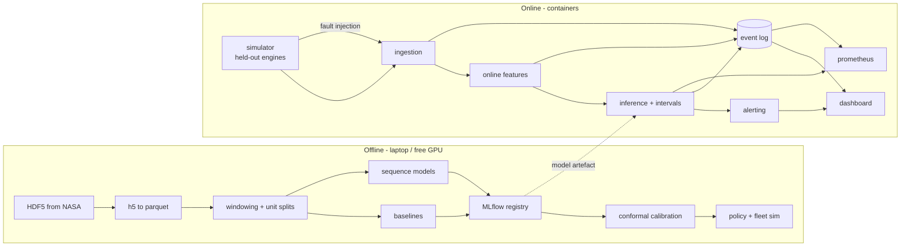

# Prognos — Design

Remaining Useful Life (RUL) prediction for turbofan engines, with calibrated
prediction intervals, a cost-based maintenance policy, and a streaming pipeline
that replays held-out engines as a live fleet.

Status: Phases 0–5 are built and merged; Phase 6 (launch) is in progress. This
document was written in Phase 0 and is kept as the design of record. Where the build
departed from it, §14 says how and why, and the README carries the measured results.

| Section | Built | Not built yet |
| --- | --- | --- |
| §4.2 Data pipeline | Conversion, manifest, windowing, engine splits, leakage test | — |
| §4.3 Models | Mean, linear-cycle, trend, LightGBM, CNN, LSTM, Transformer | — |
| §4.4 Uncertainty | Split conformal and CQR, offline and live coverage | — |
| §4.5 Decision layer | Lower-bound and point policies, run-to-failure, fixed interval, ratio sweep | — |
| §4.6 Streaming | Replay, online window, inference, alerting, fleet view, cost panel, auth | Hosted demo |
| §4.7 Sensor faults | Dropout, stuck, drift, out-of-range, cycle regression, silence | Operating-condition shift; drift detector false positives (README, Limitations) |
| §4.8 Monitoring | Prometheus metrics, Grafana dashboard, structured logs | OpenTelemetry tracing (spans are in-process today) |
| §4.9 MLOps | YAML configs, data checksums, training CLI, CI smoke run | MLflow tracking and registry, model card |

---

## 1. Context

Turbofan engines are monitored continuously while in service, but they are
scheduled for maintenance on a fixed calendar or cycle interval regardless of
their actual condition. A component-based ("run-to-failure") engine wears out
on a schedule set by the fleet, not by its own state.

The N-CMAPSS dataset gives run-to-failure trajectories from a simulated
two-spool engine under realistic flight profiles. It is the current reference
benchmark for data-driven RUL estimation, and it is where almost all published
RUL results are reported. Prognos uses it to answer three questions in order:

1. How much useful life is left, with an honest uncertainty range?
2. Given that range and a cost model, when should the fleet replace an engine?
3. Can that answer be produced continuously, per engine, from a live sensor
   stream — and does it fail loudly rather than silently when the data is bad?

The third question is what separates this from a notebook. A RUL model that
outputs a number with no interval and no failure behaviour is not deployable in
maintenance, which is where RUL predictions actually get used.

### Dataset

Source: NASA Prognostics Center of Excellence Data Repository, data set 17,
"Turbofan Engine Degradation Simulation Data Set 2" (N-CMAPSS).

Access verified 2026-10-09:

| Property | Value |
| --- | --- |
| URL | `https://phm-datasets.s3.amazonaws.com/NASA/17.+Turbofan+Engine+Degradation+Simulation+Data+Set+2.zip` |
| HTTP status | `200 OK` |
| `Content-Length` | 15,760,443,389 bytes (14.68 GiB) |
| `Last-Modified` | Sun, 18 Sep 2022 03:42:06 GMT |
| Layout | zip64, contains a nested `data_set.zip` (15,814,385,805 bytes uncompressed), which holds per-sub-dataset HDF5 files |
| Range requests | supported (`Accept-Ranges: bytes`), so per-file extraction without a full download is possible |

Terms of use, from the repository page: the data sets are publicly available and
distributed without restriction; users employ them at their own risk and neither
NASA nor the donors assume liability for the data or for systems built on it.
Publications using these data sets are asked to acknowledge the assistance of the
repository and the data donors. This project complies: the required citation
appears in the README and the data is never redistributed in this repository, only
downloaded by a script.

Citation:
M. Chao, C. Kulkarni, K. Goebel, O. Fink, *Aircraft Engine Run-to-Failure Dataset
under real flight conditions*, NASA Prognostics Center of Excellence Data
Repository, NASA Ames Research Center, 2021.

Measured layout of each sub-dataset HDF5 file, 2026-10-09. The file is a set of
flat matrices, one row per sensor reading, with a parallel array of variable names:

| Group | Shape | Contents | Usable at inference? |
| --- | --- | --- | --- |
| `A` | `(rows, 4)` | `unit`, `cycle`, flight class, health state | `unit` and `cycle` yes, health state no |
| `W` | `(rows, 4)` | Scenario descriptors: `alt`, `Mach`, `TRA`, `T2` | Yes — known on an aircraft before the engine starts |
| `X_s` | `(rows, 14)` | Measured condition-monitoring signals | Yes — this is what real sensors produce |
| `X_v` | `(rows, 14)` | Virtual (non-physical) sensor estimates | No — inferred from the health parameters |
| `T` | `(rows, 10)` | True health parameters: per-module `*_eff_mod` and `*_flow_mod` | **Never.** Ground truth from the simulator |
| `Y` | `(rows, 1)` | RUL label in cycles | Target, not an input |

Each has a `_dev` and a `_test` suffix, plus a `_var` array holding the variable
names. An earlier version of this document described per-unit HDF5 groups and called
the health parameters `theta`; that was wrong, and `prognos.convert` matches the real
layout above.

Two consequences that are easy to get wrong:

- **There is no time column.** Row order within a cycle is the flight's time axis. A
  DS02 cycle holds 5,500 to 18,000 rows, so windowing has to downsample to mean
  anything.
- **Unit numbers restart in every sub-dataset.** DS01 unit 2 and DS02 unit 2 are
  different engines. Engine identity is the (sub-dataset, unit) pair, and every
  split in this project groups on that pair rather than the bare number. See
  ADR-0003.

`T` is the leakage hazard. It is generated by the same simulator process that
generates the measurements, so it is not merely correlated with RUL — it is close to
a linear encoding of it. Any model that sees `T` scores well and is useless. This is
enforced structurally rather than by convention: the converter never reads `T` or
`X_v`, so downstream code cannot reach them, and `tests/test_leakage.py` proves it
from a deliberately poisoned input file. See ADR-0002.

### Sub-dataset selection

The full archive is ~14.7 GiB across the nine readable sub-datasets
(DS01–DS07, DS08a, DS08c; DS08d's HDF5 is unreadable in the published
benchmark literature). It does not fit the constraint that everything must run on
one 16 GB laptop plus free-tier GPUs, and most of it is not needed to answer the
questions above.

| Sub-dataset | Failure modes | Flight classes | Units | Why in or out |
| --- | --- | --- | --- | --- |
| DS02 | 1 (HPC) | 3 | 9 | **Primary.** The most-cited sub-dataset in the N-CMAPSS literature, single failure mode, varying flight classes. This is where a published comparison exists. |
| DS01 | 1 (HPC) | 1 | 10 | **Secondary.** Cleanest isolation of degradation from operating regime. Gives the degradation-trend baseline a fair shot. |
| DS06 | 5 (HPC, LPC, HPT, LPT, fan) | 3 | 10 | **Tertiary.** Multiple failure modes, so it tests whether the model learned degradation or one failure signature. |
| DS03–DS05, DS07, DS08a, DS08c | 2–7 | mixed | 10–15 | Out. Multi-fault variants of the above; they add units, not questions. Revisit only if DS06 shows the model is failure-mode specific and the effect is measurable. |

Per-file byte sizes, measured from the archive listing on 2026-10-09 and recorded
in `docs/data.md`: DS01 2,873 MB, DS02 2,450 MB, DS06 2,549 MB, 7.9 GB for the
three in scope, 29.2 GB for the full archive.

Converted, the three in scope hold 20,938,714 rows across 29 engines, which is
1.3 GiB of Parquet. Conversion takes 56 s on the reference machine. Both the HDF5
and the Parquet fit in 16 GB RAM.

---

## 2. Goals and non-goals

### Goals

1. **Point and interval RUL.** For each engine and each point in its life, a
   point estimate of RUL and a prediction interval that empirically covers the
   truth at a stated rate.
2. **Cost-optimal decisions.** A maintenance policy that acts on the interval,
   not the point estimate, chosen to minimise expected cost under a configurable
   cost model, and measured against run-to-failure and fixed-interval policies.
3. **A streaming system.** Ingestion → online features → inference → alerting,
   processing held-out engines at accelerated time, with explicit handling of
   late and out-of-order data.
4. **Loud failure.** Stuck, flat-lined, out-of-range and missing sensors, plus
   inference outage and regime shift, all produce a named degraded state and an
   alert. A silently wrong RUL is treated as a worse outcome than no RUL.

### Non-goals

- **No physics-based degradation modelling.** No C-MAPSS equations, no
  Kalman-filter-on-a-mechanistic-model. Purely data-driven.
- **No real aircraft data.** N-CMAPSS is simulated. Nothing here transfers to a
  real engine without a validation campaign that this project does not run.
- **No certification-grade safety claims.** This is not airworthy, and the
  README will say so in the same words. See §9.
- No multi-tenant auth, no billing, no mobile clients, no Kubernetes.

---

## 3. Requirements and SLOs

Latency SLOs are measured on the stated hardware in §8 and reported with the
measurement, not asserted.

### Offline (training and evaluation)

| ID | Requirement |
| --- | --- |
| R1 | Every reported number is produced by a committed script, with the command shown and raw output committed under `results/`. Hardware, versions, seeds and dates recorded. |
| R2 | Split by engine, where an engine is a (sub-dataset, unit) pair. No engine appears in more than one of train / validation / test. Enforced by a test. |
| R3 | The health parameters (`T`) and virtual sensors (`X_v`) are never read from HDF5. No leaking column can reach a model input, because it is never loaded. Enforced by a test. |
| R4 | All model training is seeded and reproducible: same seed, same metrics, on the same machine. |
| R5 | Cross-validation grouped by engine, reported with confidence intervals resampled by engine. |
| R6 | Intervals achieve target coverage (90% default) within a stated tolerance, reported with empirical coverage and mean width. |
| R7 | Cost comparison covers at least run-to-failure and fixed-interval, over a fleet simulation, with expected cost and confidence intervals and all cost assumptions stated. |

### Online (streaming)

| ID | SLO | Target |
| --- | --- | --- |
| S1 | End-to-end latency: sensor reading accepted → updated RUL available | p95 ≤ 2 s per engine cycle |
| S2 | Throughput | ≥ 20 engine cycles/s sustained, single replica |
| S3 | Prediction availability | 99.5% over the demo window, excluding planned restarts |
| S4 | Fault detection → degraded state raised | ≤ 3 engine cycles |
| S5 | Interval coverage in production | within ±5 pp of the 90% target, measured monthly |
| S6 | Never silently wrong | any degraded state must be observable in metrics, logs and the dashboard |

S1 and S2 are deliberately loose relative to the data rate. N-CMAPSS is one
reading per second per engine; the fleet is tens of engines. The interesting
constraint is not raw throughput, it is that latency does not degrade
unpredictably as the window fills or as degraded states accumulate. The load test
measures the tail, not the mean.

### Quality gates

- mypy `--strict`, ruff, and format checks pass in CI.
- ≥ 85% line coverage on core logic (`rul`, `uncertainty`, `decision`,
  `features`, `ingest`, `faults`).
- A test fails CI when a README figure drifts from the committed result file.
- Dependency scanning (pip-audit, Trivy on images) and secret scanning run on
  every pull request. Dependabot security alerts stay on; no bot authors commits.

---

## 4. Design

### 4.1 System shape

### 4.2 Data pipeline

1. **Fetch.** A script downloads the archive and verifies the SHA-256 against a
   pinned value. The archive is not committed.
2. **Extract.** Per-sub-dataset HDF5 is extracted from the nested zip. Because
   S3 supports range requests, the script fetches only the needed member
   files rather than the whole 14.7 GiB archive.
3. **Convert.** Each unit becomes its own Parquet file, one row per sensor
   reading, with columns from `W` and `X_s` only. `T` and `X_v` are never
   loaded, so they cannot be carried and filtered later. Not reading them is
   stronger than dropping them: a filter that runs after `load()` is one
   refactor away from being applied in the wrong place.
4. **Manifest.** `data/manifest.json` records per-file SHA-256, row counts,
   unit IDs, cycle counts and RUL targets. This is the reproducibility anchor:
   any change to the data changes the manifest.
5. **Window.** Sliding windows along a cycle's time axis, within a single cycle and
   within a single engine. The RUL label comes from the dataset's own `Y` column,
   capped so early-life windows are not all labelled with one engine's full life.
   Windows do not cross cycle or engine boundaries.
6. **Split.** `GroupKFold` on the engine key for cross-validation; one held-out
   group of engines reserved as the final test set, never opened until the model is
   frozen.

### 4.3 Models

Ordered by increasing cost to train, and each one must beat the previous one to
justify the next.

| Model | Purpose | Why it earns its place |
| --- | --- | --- |
| **Mean** | Sanity floor | If a fancier model cannot beat "predict the training mean", the model is noise. |
| **Linear on cycle number** | The real floor | Uses no sensor data at all. Phase 2 measured it at RMSE 8.90 against LightGBM's 8.15, which says most of the predictable signal in a short window is how old the engine is. A sequence model that does not beat this has not shown that sensor data helps. |
| **Degradation-trend** | Physics-adjacent baseline | Per-channel slope extrapolated to a degradation threshold. Interpretable, and it fails informatively when the window is too short to support it. |
| **LightGBM** on engineered window features | Strong tabular baseline | Window statistics (mean, slope, last value, range per channel) plus cycle context. The bar a sequence model has to clear on accuracy. |
| **1D CNN** | Sequence model | Conv over the time axis. Fast on MPS, and the cheapest way to find out whether the window shape matters at all. |
| **LSTM** or **Transformer** | Sequence model | Recurrent vs attention over the window. LSTM is the literature default here; the Transformer is the honest "did we outgrow recurrence" check. Both are built; whichever wins on grouped CV is reported as the primary. |

Fixed seeds, configs in YAML, every run logged to MLflow with its git SHA.
Training on Apple MPS for the CNN/LSTM. If a run needs more than a laptop
comfortably allows, Colab or Kaggle free GPUs, with checkpoints resumed rather
than restarted.

### 4.4 Uncertainty

Point estimates alone are not actionable for maintenance, because the decision is
"replace or do not replace" and the two errors are not symmetric.

- **Split conformal** on held-out residuals gives a marginal-coverage guarantee at
  the target rate, with no distributional assumption. Cheap, model-agnostic, and
  the default.
- **Conformalised quantile regression (CQR)** wraps quantile regressors and adapts
  the interval width locally, which matters here because error is not constant
  across the life cycle — early-life windows are far more uncertain than
  late-life ones. Reported alongside split conformal so the width difference is
  visible.
- Coverage is monitored over time in the streaming phase, not just offline. A
  model whose offline coverage is 90% and whose live coverage is 71% is a
  degraded system, and S5 exists to catch exactly that.

### 4.5 Decision layer

The policy acts on the **lower bound** of the interval, not the point estimate.
Replace when `rul_lower ≤ threshold`. Rationale: the cost of an unnecessary
replacement is bounded and known; the cost of running an engine past its life is
larger and unbounded in the tail.

Cost model, all values configurable in YAML and all stated alongside every cost
result:

| Term | Meaning |
| --- | --- |
| `unplanned_failure_cost` | Cost of an in-flight or unplanned removal: engine, logistics, schedule disruption |
| `planned_maintenance_cost` | Cost of a scheduled visit at the chosen RUL threshold |
| `downtime_cost_per_cycle` | Cost of each cycle an engine spends on the ground |
| `maintenance_window_cycles` | Ground time consumed by a planned visit, in cycles |
| `replacement_engine_life` | Cycles a replacement delivers before it fails again, used to charge replacement cost across its life rather than to the policy that triggered it |

Comparisons, all on the same fleet simulation:

1. Run-to-failure — replace on failure.
2. Fixed-interval — replace every *N* cycles, *N* swept.
3. Interval-threshold policy at the point estimate.
4. Interval-threshold policy at the lower bound. **The one under test.**

Expected cost is reported with confidence intervals from repeated simulation runs
over the held-out fleet, and every cost number in the README is accompanied by
the cost configuration that produced it. A sensitivity sweep over the cost
parameters is reported too, because a policy that only wins under one cost
assumption is not a result.

### 4.6 Streaming pipeline

Six components, each a container, each with a health and a readiness endpoint:

| Component | Responsibility |
| --- | --- |
| `simulator` | Replays held-out engine flights as a live sensor stream at accelerated time. Owns fault injection. |
| `ingestion` | Accepts sensor readings, validates, assigns event time, handles late and out-of-order arrivals |
| `features` | Online window computation, identical arithmetic to the offline feature builder |
| `inference` | Loads the registered model, returns RUL with a conformal interval |
| `alerting` | Raises, deduplicates and resolves maintenance and system alerts |
| `dashboard` | Fleet view, alerts, cost panel, fault and drift injection controls |

The critical design constraint is that **online features and offline features must
be the same code path**, not two implementations that agree today and drift
tomorrow. The feature builder takes a window and returns a feature vector; offline
it is fed Parquet, online it is fed the streaming buffer. A test asserts they
agree on identical input.

Out-of-order and late data is handled explicitly, not ignored:

- Each reading carries `(unit_id, flight_id, t_event, t_ingest)`.
- The window buffer sorts by `t_event` within a bounded lateness horizon
  (configurable, default 30 s).
- Readings arriving after the horizon are counted in a `late_dropped_total`
  counter and logged; they do not silently corrupt a window.
- Re-processing a corrected flight is idempotent: the window is keyed by
  `(unit_id, flight_id, start_index, length)` and rebuilt, not appended to.

### 4.7 Sensor fault handling

Each fault has a detector, a confidence consequence, and an alert. The
confidence consequence is the part that matters: a degraded engine reports a
wider interval or no prediction at all, and says which.

| Fault | Detection | Response |
| --- | --- | --- |
| Stuck / flat-lined | Zero variance over a sliding window longer than *k* cycles | Freeze the affected channels, widen the interval, `low_confidence` state, alert |
| Out-of-range | Outside range learned from training units | Clamp, flag channel, `low_confidence`, alert |
| Missing / NaN | Null or non-finite | Channel imputed from the conditional mean, mask emitted as a feature, alert |
| Channel dropout | Entire channel absent for > *k* cycles | Model falls back to models without that channel if one exists, else `insufficient_data` |
| Regime shift | Drift score on operating conditions (PSI) over threshold | Retrain flag raised, interval widened, alert. No silent continuation. |
| Inference outage | Health check fails / restarts | Cached last-good RUL served with its age, `stale` state, alert on raise and on clear |

`low_confidence` is a first-class output, not an error. The dashboard shows the
state; the RUL is still useful, it is just marked.

### 4.8 Monitoring

- **Metrics (Prometheus).** Request rate, error rate, duration histograms for
  every service; domain metrics: `rul_predictions_total`,
  `interval_width_cycles`, `rul_lower_bound_cycles`, `conformal_coverage_ratio`,
  `alerts_active`, `sensor_fault_total{fault_type}`, `late_events_dropped_total`,
  `drift_score{feature}`, `inference_latency_seconds`.
- **Dashboards.** Committed Grafana dashboard JSON, covering both golden signals
  and the domain metrics.
- **Logs.** Structured JSON, one object per line, with `request_id` and
  `unit_id` on every request-scoped line.
- **Tracing.** OpenTelemetry spans across ingestion → features → inference, so a
  slow prediction can be attributed to a stage rather than guessed at.

### 4.9 MLOps

- MLflow tracking server, local backend + registry.
- YAML configs, layered: `configs/base.yaml` → `configs/{phase,env}.yaml`.
- `prognos train --config ...` CLI, resumable, rate-limit aware, writes a run
  directory that MLflow points at.
- A model card per registered model: training data, splits, metrics with
  intervals, known failure modes, intended and unintended use.
- CI smoke run: tiny subset, few epochs, asserts the pipeline runs end to end
  and the leakage test passes. Under 10 minutes.

---

## 5. Evaluation protocol

### Point accuracy

| Metric | Definition |
| --- | --- |
| RMSE | In cycles, over all test windows |
| **NASA asymmetric score** | `d = rul_pred − rul_true`; `s(d) = exp(−d/13) − 1` for `d < 0`, `exp(d/10) − 1` for `d ≥ 0`; total is the sum. Over-prediction is penalised roughly 1.8× more steeply than under-prediction of the same magnitude, which encodes that saying an engine has more life than it does is the dangerous error. |

Both are reported for every model, because RMSE alone hides exactly the error
mode that matters operationally.

### Where the errors are

Error is broken down by life stage — early, mid, late — defined by RUL fraction
of total life with cut points declared in config. Late-life accuracy is what
drives maintenance decisions; a model that is excellent early and useless at
100 cycles remaining is not useful.

### Uncertainty quality

- Empirical coverage vs the 90% target.
- Mean and median interval width, in cycles.
- Coverage broken down by life stage and by sub-dataset, because a model can
  hold coverage on average while failing badly in the regime that triggers
  alerts.

### Business outcome

Expected maintenance cost per policy from the fleet simulation, with confidence
intervals across repeated runs, the cost configuration printed next to the
number, and a sensitivity sweep over the cost parameters.

### Published comparison

Compared against published N-CMAPSS results where the sub-dataset, window
protocol and RUL-capping match. Where they do not match, the difference is stated
rather than glossed. A published RMSE from a different window length on a
different split is not a comparison, and presenting one as a comparison is worse
than presenting none.

### Honest-evaluation rules

- Test and attack sets are written before the fix they evaluate.
- Hyperparameters are never tuned on the set that is reported.
- The final test group is opened once, after the model is frozen.
- No number is estimated, rounded up, or cherry-picked. If a run was worse than
  the previous one, it is in the table.

---

## 6. Alternatives considered

| Decision | Chosen | Rejected | Why |
| --- | --- | --- | --- |
| Dataset | N-CMAPSS | C-MAPSS (data set 6), PHM21 challenge subset | C-MAPSS has one synthetic operating snapshot per cycle and hides regime effects. N-CMAPSS has full flight traces, which is what makes the streaming and drift work meaningful. The PHM21 challenge data is a gated subset. |
| Sequence depth model | LSTM + Transformer, CNN as a cheaper probe | TSMixer / PatchTST | Both work and are reported in the literature as strong. Adding two more architectures exceeds what one laptop and the interview-explainer goal justify. Revisit if the Transformer loses to the CNN. |
| Uncertainty | Split conformal + CQR | Bayesian NN / deep ensembles | Conformal gives finite-sample coverage without assumptions and costs one calibration pass. Ensembles triple inference cost and complicate the registry. Cheap to add later behind the same interface. |
| Feature code | One shared builder | Separate offline and online implementations | Guaranteed drift otherwise. The shared path costs a little abstraction and saves the most expensive class of bug in a streaming system. |
| Streaming transport | Single-node Docker Compose, in-memory event log + SQLite metadata | Kafka, managed queues | The fleet is tens of engines. Kafka is a cluster to operate for a workload that fits in one container, and it would dominate the $0 budget in engineering time. The event log abstraction keeps the door open. |
| Hosted MLflow | Local server | Managed MLflow, Weights & Biases | Managed tiers cost money or cap free usage unpredictably. Local MLflow with a committed registry state file is enough and inspectable. |
| Dashboard | Single-page app on free static hosting + live API | Gradio on a Spaces runtime | Free Spaces runtimes now require a paid plan for compute, so a permanent always-on dashboard is not reliably free. Static hosting plus a public API is. |

---

## 7. Trade-offs

- **Small dataset, small fleet.** Nine to ten engines per sub-dataset, 29 across
  the three in scope. Grouped cross-validation on 29 engines still gives wide
  confidence intervals: Phase 2 measured LightGBM at RMSE 8.15 with a 95% interval
  of 4.23 to 12.07. That width is the honest state of the benchmark, and reporting
  it is preferable to hiding it.
- **Simulated data.** Results transfer to the benchmark, not to an engine. The
  failure-injection and degradation work is the part most likely to transfer.
- **Narrow sub-dataset selection.** Three sub-datasets means limited evidence
  about failure-mode generality. DS06 is included precisely to get some.
- **One-box deployment.** No redundancy. Free tier does not offer it, and a
  single-box failure is covered by the runbook and by a health-check-driven
  degraded state instead.
- **Point-estimate models plus conformal rather than natively probabilistic
  models.** Conformal is easy to trust and easy to explain in an interview, but
  it is a marginal guarantee. Where heteroscedasticity matters, CQR recovers much
  of the lost adaptivity at modest cost.
- **Accelerated-time simulation, not a real-time feed.** Latency numbers are
  measured against simulated arrival timing and are honest about that in the
  README.

---

## 8. Hardware and hosting plan

### Training

| Use | Hardware | Notes |
| --- | --- | --- |
| Primary | Apple M5, 16 GB, macOS | MPS for CNN/LSTM; LightGBM and all evaluation on CPU. This is the documented reference machine for every reported number. |
| Oversized runs | Colab / Kaggle free GPUs | Only when a config is measured to exceed a sensible laptop budget. Checkpoints resume, so a session timeout is not a lost run. |

### Hosting — proposed plan, $0

| Component | Platform | Rationale and constraint |
| --- | --- | --- |
| API services (ingestion, features, inference, alerting, simulator) | Docker Compose on an **Oracle Cloud Always Free** VM.Standard.A1.Flex instance | Always Free ARM A1 covers 2 OCPU / 12 GB total as of July 2026, sufficient for tens of engines. Requires an ARM64 image base; all dependencies must have `linux/arm64` wheels, which is a real constraint on some ML packages and is checked in CI. |
| Dashboard | **Vercel** or **Netlify** static hosting | Unused free tier, no cold-start problem for a static bundle. |
| Model artefacts and config | GitHub Releases on the repo | Regenerable, versioned, no hosting cost. |
| Observability | Prometheus + Grafana in the same Compose stack | Committing dashboard definitions, no external SaaS. |
| Fallback | **Render** free web service | Free tier spins down after 15 min of inactivity, so latency numbers would not be representative. Only if Oracle signup is unavailable; recorded as a known SLO caveat. |

Alternative considered: Hugging Face Spaces. Rejected because compute-based
Spaces now require a paid plan, so an always-on dashboard is not reliably free.
Oracle capacity is occasionally unavailable in some regions; the fallback is
documented rather than improvised.

If Oracle signup fails and Render is used, S1 and S2 are reported as
cold-start-inclusive, and the README says so. I would rather degrade the claim
than the honesty.

---

## 9. Limitations

To be carried into the README verbatim, so the demo cannot be read as stronger
than it is:

1. All results are on **simulated** data from a specific engine model. No
   aircraft flew these engines.
2. No physics-based degradation model, and no claim that one is unnecessary.
   A hybrid model would likely be more robust to regime shift than anything here.
3. The cost model is an **assumption set**, not observed airline economics. Cost
   conclusions hold only under the stated parameters, and the sensitivity sweep
   is reported so the reader can see where they stop holding.
4. No airworthiness or safety certification is claimed or implied. This system is
   a research demonstration and must not be used to decide whether an aircraft is
   safe to fly.
5. Small dataset: 9–10 engines per sub-dataset, 29 in total, so confidence
   intervals on model comparisons are wide and many plausible models are
   statistically indistinguishable on this evidence.
6. Sub-dataset selection is three of nine. Claims about failure-mode generality
   rest on DS06 alone.
7. Latency and throughput are measured against a simulator at accelerated time on
   the hardware named in §8, not on an aircraft datalink.
8. Conformal prediction gives a **marginal** coverage guarantee. Under shift, the
   realised coverage can differ from nominal, which is why coverage monitoring is
   a live SLO rather than an offline number.
9. The policy assumes maintenance can be scheduled at any predicted threshold.
   Real maintenance has calendar, hangar and crew constraints that this
   simulation does not model.

---

## 10. Risks

| Risk | Likelihood | Impact | Mitigation |
| --- | --- | --- | --- |
| N-CMAPSS archive turns out to be unusable or unreadable at scale | Low (access verified, 29 engines converted) | Blocks everything | Range-request extraction; DS02 alone is 2.45 GB of HDF5 |
| Published comparison cannot be matched exactly | **High** | Weakens the benchmark claim | Report the mismatch explicitly; compare against our own reproduced baselines as the primary reference |
| Free-tier hosting unavailable or too cold | Medium | Demo unavailable | Oracle primary, Render fallback, static dashboard independent of the API |
| MPS training is slow or numerically awkward | Medium | Longer iteration | CPU fallback for small models; Colab for big ones |
| ARM64 wheels missing for a dependency | Medium | Blocks deployment | Check `linux/arm64` availability in CI early; pin to versions that have them. LightGBM also needs the system OpenMP runtime (`libgomp1` in the image, `brew install libomp` locally), which is not a Python dependency and will not show up in a lockfile audit. |
| Overfitting to 29 engines | **High** | Overstated results | Grouped CV, frozen test group, attention to interval width, life-stage breakdown |
| Confidence in intervals that are quietly too narrow | Medium | Unsafe decisions | Coverage monitoring as a live SLO; lower-bound policy by default |
| Cost model drives the conclusion rather than the data | Medium | Meaningless business result | Sensitivity sweep; report where the policy ranking flips |
| Scope creep into a platform | Medium | Nothing finished | Phase gates and the stop-after-each-phase rule |

---

## 11. Threat model

Scope: a public read-only dashboard, a public write API for sensor readings, a
demo-only control endpoint that injects faults, and local training.

Assets: model artefacts (integrity), the API (availability), the demo host
(no credentials of value), and the honesty of the reported results.

Trust boundaries: browser → dashboard; dashboard → API; API → event log and
model registry; simulator → ingestion.

| Threat | Mitigation |
| --- | --- |
| Spoofed sensor readings from the public write API | Read-only model output; no state-changing action is reachable from injected data. An attacker who can send readings can at worst make a demo engine look unhealthy. Documented, and it is a demo, not a control system. |
| Request flooding / resource exhaustion | Per-IP and per-unit rate limits, request body size caps, max window length, bounded buffers, strict timeouts. Rate-limit and size-limit decisions are unit-tested. |
| Injected hostile values (NaN, Inf, huge integers, malformed JSON, wrong types) | Pydantic validation with strict types at the boundary; every field range-checked; NaN and Inf rejected rather than propagated |
| Out-of-order or replayed readings | `t_event` and `t_ingest` are both validated, ordering is enforced against a lateness horizon, and window keys make reprocessing idempotent |
| Path traversal or unsafe deserialization in the ingestion path | Fixed dataset paths from config, no user-supplied paths; Parquet and HDF5 reads confined to the data directory |
| Model artefact tampering | Artefacts checksummed at load; registry state committed to the repo so tampering is a visible diff; the load path fails closed on checksum mismatch |
| Secret leakage | Keys only from the environment, never logged, never committed. `.env` gitignored, `.env.example` committed with empty values. Pre-commit secret scanning plus CI secret scanning. |
| Container escape or vulnerable base image | Pinned base image digests, non-root user, read-only root filesystem where possible, dropped capabilities, Trivy image scanning in CI |
| Dependency supply chain | Locked dependencies with hashes, pip-audit and Trivy in CI, Dependabot security alerts enabled |
| Demo control endpoint abuse | Fault injection is idempotent and bounded, rate-limited, and behind a separate token; it cannot write arbitrary data |
| Denial of the demo itself | Single box, no redundancy. The failure mode is a dead demo, not a wrong prediction. Degraded states are still reported rather than suppressed. |

Deliberately out of scope: authentication and authorisation for end users,
multi-tenancy, encryption at rest beyond platform defaults, and anything that
would imply the system is suitable for flight. The system is a demonstration; the
threat model protects the demonstration, and says so.

---

## 12. Phase plan

| Phase | Content | Exit criterion |
| --- | --- | --- |
| 0 | This document, ADRs | User review |
| 1 | Repo layout, CI, HDF5 → Parquet, windowing, engine splits, leakage test | Leakage test passes; data manifest committed; CI green |
| 2 | Mean and linear-cycle floors, trend baseline, LightGBM, full evaluation harness | A model beats the mean floor; harness produces committed result files |
| 3 | CNN, LSTM, Transformer; comparison and life-stage analysis | Sequence models compared on grouped CV with intervals |
| 4 | Conformal intervals, cost policy, fleet simulation | Coverage near target; cost ranking with sensitivity sweep |
| 5 | Simulator, ingestion, online features, inference, alerts, fault handling, monitoring, failure tests | Every injected fault produces a named degraded state and an alert, with results committed |
| 6 | Dashboard, demo video, documentation, `v1.0.0` | Live demo up, README figures match committed results |

## 13. Decisions needing user input

1. **Sub-dataset scope.** DS02 + DS01 + DS06 are in use and produce 29 engines,
   199,095 windows, 64 s per cross-validation run. Narrowing to DS02 alone would cut
   iteration time roughly threefold at the cost of losing the multi-failure-mode
   evidence from DS06. Current answer: keep all three.
2. **Hosting.** Oracle Always Free A1 as the demo host, with Render as fallback,
   or prefer Render from the start and accept cold starts.
3. **Cost parameters.** The default cost table is a placeholder grounded in
   published turbofan maintenance economics. The owner should replace it with
   numbers they trust before the cost result means anything. This blocks Phase 4
   from meaning anything and needs an answer before then.
4. **Sequence models.** Build both LSTM and Transformer, or LSTM only to save a
   week. Both is the recommendation.

## 14. Corrections log

The design doc was written before the data was read, and two things in it were
wrong. Both are recorded here rather than quietly edited, because a design document
that never shows a correction is one you cannot rely on.

**Phase 1, dataset layout.** The document described per-unit HDF5 groups and called
the health parameters `theta`. The files are flat matrices — `A`, `W`, `X_s`, `X_v`,
`T`, `Y`, each with `_dev`/`_test`/`_var` variants — and the health parameters are
`T`. The hazard and the response are unchanged; only the names were wrong. Fixed in
§1 and in ADR-0002, which also now records that the converter never reads `T` rather
than reading and dropping it.

**Phase 2, engine identity.** The document said to split on "engine unit ID".
N-CMAPSS restarts unit numbers per sub-dataset, so unit ID alone merges different
engines. Implemented that way, it reported 16 engines where there are 29. An engine
is now the (sub-dataset, unit) pair. Fixed in §1, §4.2 and ADR-0003, and recorded
here because the wrong version produced numbers that looked entirely reasonable.

Neither correction changed the design, only the description of the thing the design
was operating on. That is the usual outcome, and it is the reason to measure before
writing.